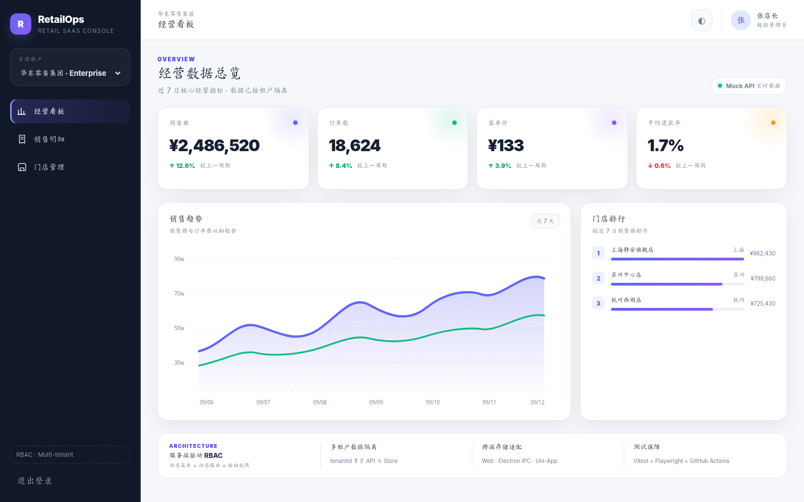
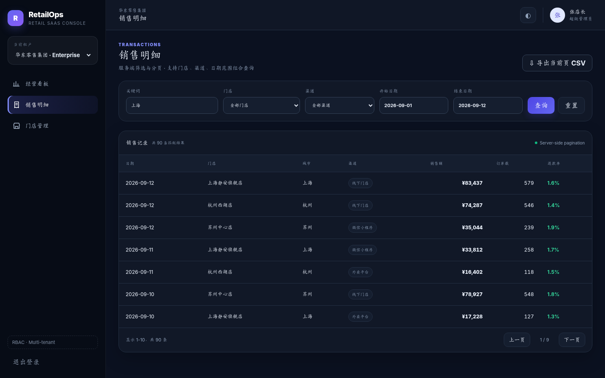
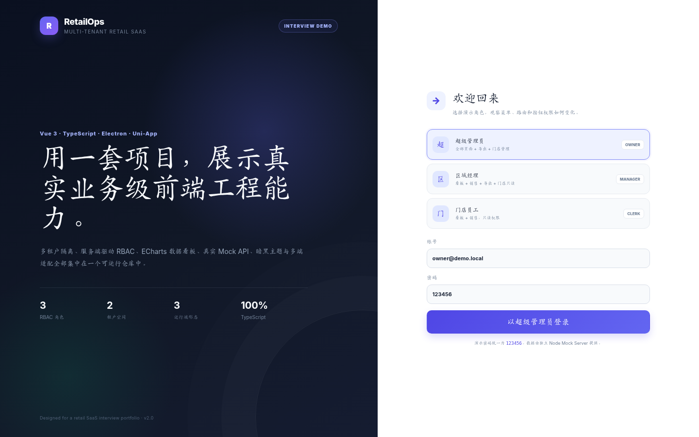

# RetailOps · Multi-tenant Retail SaaS

> V3 商业级零售 SaaS：**订单运营抽屉 + 门店 CRUD + RBAC 管理中心 + i18n + 监控 SDK + 10 万行虚拟列表 + OpenAPI + 云部署**。

## 🚀 Live Demo

Vercel Web 与 Cloudflare Workers 配置已经就绪。连接部署账号后，按 [`docs/deployment/ONLINE_DEMO.md`](docs/deployment/ONLINE_DEMO.md) 发布并回填正式地址。

## V3 能力

| 模块 | 实现 |
|---|---|
| 订单详情 | Teleport / Transition Drawer、客户、商品、支付与 Timeline |
| 门店管理 | 新增/编辑复用表单、Zod 校验、防重复提交 |
| RBAC | 角色列表、权限矩阵、服务端更新与菜单刷新 |
| 国际化 | vue-i18n 中英文切换与 Intl 格式化基础设施 |
| 可观测性 | JS Error、Promise rejection、FCP/TTFB 与行为埋点 |
| 性能 | 100,000 行定高虚拟列表，只渲染可视区域 |
| 契约 | OpenAPI 3.1 + `npm run generate:api` 自动生成 TypeScript |
| 部署 | Vercel SPA 配置 + Cloudflare Worker/KV 示例 |


## Preview



<details>
<summary>查看更多截图</summary>

### 暗黑主题 + 服务端筛选分页



### 登录页 + 三种 RBAC 角色



</details>

## 项目亮点

这不是一个只展示 CRUD 的后台模板。项目围绕“零售门店 SaaS”实现了完整的面试演示链路：登录后由独立 Mock API 返回用户、租户、权限和菜单；前端据此动态注册路由；销售页面使用服务端筛选和分页；经营看板用 ECharts 展示趋势；桌面端通过 Electron preload + IPC 暴露受控能力；`apps/uni-retail` 则提供独立的 Uni-App 多端子项目。

| 岗位要求 / 能力 | 项目中的体现 |
|---|---|
| Vue 3 / Composition API / Router / Pinia | `src/views`、`src/router`、`src/stores` |
| TypeScript | strict mode、领域类型、API DTO、权限联合类型 |
| SCSS / Sass | `src/styles/index.scss`，主题 token、响应式、语义化样式 |
| Atomic CSS | UnoCSS + 模板 utility class，与语义 SCSS 混合使用 |
| ECharts | `src/components/charts/SalesTrendChart.vue` |
| 动态 RBAC | 服务端菜单 + 动态路由 + route guard + `v-permission` |
| 多租户 SaaS | 租户切换、`tenantId` API 边界、服务端二次校验 |
| 筛选 / 分页 | `/api/sales` 服务端 keyword/store/channel/date/page 查询 |
| 真实 Mock Server | `mock-server/server.mjs`，独立 Node HTTP API |
| 暗黑主题 | CSS Variables + Pinia Theme Store + ECharts theme re-init |
| Electron | main / preload / IPC / contextIsolation / 本地 KV 存储 |
| Uni-App | `apps/uni-retail`：H5 / 微信小程序 / App-Plus |
| 测试 | Vitest 单测 + Playwright E2E |
| CI | GitHub Actions：typecheck、test、build、E2E |

## 快速开始

要求 Node.js 22+。

```bash
npm install
npm run dev:full
```

浏览器访问：`http://127.0.0.1:5173`

`dev:full` 会同时启动：

- Vite Web：`127.0.0.1:5173`
- Mock API：`127.0.0.1:8787`

### 演示账号

| 账号 | 密码 | 权限差异 |
|---|---|---|
| `owner@demo.local` | `123456` | 全部菜单、CSV 导出、门店管理、多租户切换 |
| `manager@demo.local` | `123456` | 看板、销售、导出、门店只读 |
| `clerk@demo.local` | `123456` | 看板 + 销售，只读；无导出、无门店管理 |

面试时建议依次登录三个账号，可以直观看到**菜单级、路由级、按钮级**三层权限差异。

## 常用命令

```bash
npm run dev:full       # Web + Mock API
npm run dev:electron   # Mock API + Vite + Electron
npm run typecheck      # vue-tsc
npm run test:unit      # Vitest
npm run test:e2e       # Playwright
npm run build          # Web production build
npm run build:desktop  # Electron Builder
```

Playwright 首次运行：

```bash
npx playwright install chromium
```

## 动态 RBAC

登录返回 `User.permissions`，随后前端请求 `/api/navigation` 获取当前角色菜单。`src/router/routes.ts` 维护 route manifest，`installAuthorizedRoutes()` 只注册服务端允许的页面。

权限共三层：

1. **菜单级**：服务端导航决定菜单是否出现。
2. **路由级**：`meta.permission` + global guard 阻止手工输入 URL 越权。
3. **按钮级**：`v-permission` 控制导出、门店状态修改等操作。

Mock Server 同样检查 token、permission 和 tenant access，因此前端隐藏按钮不被当作安全边界。

## 多租户设计

Owner 可以在“华东零售集团 / 北方生活馆”之间切换。每个 dashboard、stores、sales 请求都会显式携带 `tenantId`，服务端还会根据当前用户的 `accessibleTenantIds` 做二次校验，模拟真实 SaaS 的租户隔离逻辑。

## 真实 Mock Server

`mock-server/server.mjs` 是独立进程，而不是 Vue 页面里直接 import 一组 mock 数组。当前接口包括：

```text
POST  /api/auth/login
POST  /api/auth/logout
GET   /api/session
GET   /api/navigation
GET   /api/dashboard
GET   /api/stores
PATCH /api/stores/:id
GET   /api/sales
```

销售接口支持关键词、门店、渠道、日期范围和服务端分页，后续替换真实 REST API 时页面层无需重写分页逻辑。

## Electron 桌面端

```bash
npm run dev:electron
```

项目采用：

- `contextIsolation: true`
- `nodeIntegration: false`
- preload + `contextBridge` 暴露白名单 API
- IPC 完成本地 KV 存储和 App 信息读取
- renderer 不直接访问 `fs`

生产构建时需要让 `VITE_API_BASE_URL` 指向真实 API；仓库 Mock Server 主要用于本地演示和测试。

## Uni-App 多端子项目

完整子项目位于 [`apps/uni-retail`](apps/uni-retail)，包含：

- 登录和 Pinia Session
- 经营看板
- 销售列表 + 上拉分页 + 下拉刷新
- `uni.scanCode` 扫码能力
- H5 / MP-WEIXIN / APP-PLUS 条件编译
- `uni.requireNativePlugin` 原生插件 Bridge 示例

运行：

```bash
cd apps/uni-retail
npm install
npm run dev:h5
```

也可以用 HBuilderX 导入该目录。真机调试时需要将 API 地址改成手机可以访问的局域网 IP。

## 目录结构

```text
retail-saas-frontend/
├── apps/uni-retail/          # 完整 Uni-App 子项目
├── electron/                 # Electron main / preload / IPC
├── mock-server/              # 独立 Node Mock API
├── src/
│   ├── api/                  # HTTP client + Domain API
│   ├── components/           # 通用组件 + ECharts
│   ├── composables/          # 平台能力 composable
│   ├── directives/           # v-permission
│   ├── layouts/
│   ├── router/               # 动态路由 / 守卫
│   ├── stores/               # Auth / Theme / Dashboard / Sales / Stores
│   ├── styles/               # SCSS + CSS Variables
│   ├── types/                # Domain / DTO / Permission
│   └── views/
├── tests/e2e/                # Playwright
├── docs/                     # 架构与面试讲解
└── .github/workflows/ci.yml
```

## 本地二次开发

```bash
npm install
npm run dev:full      # 同时启动 Mock Server 与前端开发服务器
npm run dev:electron  # 启动 Electron 桌面端
npm run test          # 运行 Vitest 单元测试
npm run test:e2e      # 运行 Playwright E2E 测试
```

推送到 GitHub 后，Actions 会自动执行 typecheck、Vitest、production build 和 Playwright E2E。

## 面试讲解资料

- [`docs/ARCHITECTURE.md`](docs/ARCHITECTURE.md)：架构 / RBAC / 多租户 / Mock API / 跨端策略
- [`docs/INTERVIEW.md`](docs/INTERVIEW.md)：30 秒讲法、2 分钟演示顺序、高频追问
- [`apps/uni-retail/README.md`](apps/uni-retail/README.md)：Uni-App 运行说明

## License

MIT
